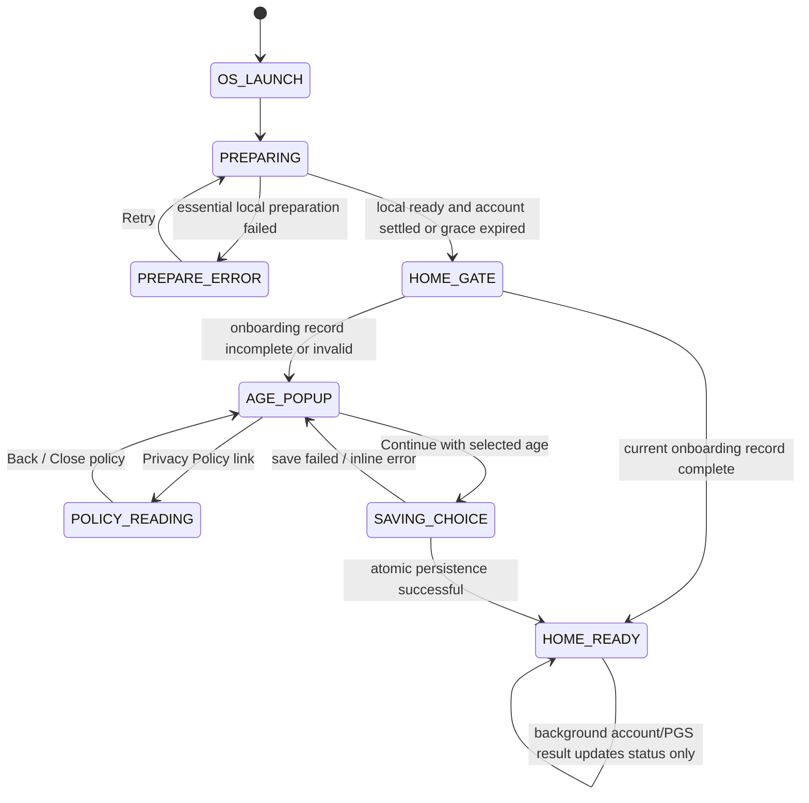

# V11 Startup Flow — चरण 1 की पूरी specification

स्थिति: **चरण 1 पूरा: flow/design contract तैयार।** 29 अक्टूबर 2026। यह runtime implementation नहीं है; launch assets/theme, splash/session और popup क्रमशः चरण 2–4 में बनेंगे। Payment/pricing/release इस चरण से बाहर हैं। यह document V11_IMPLEMENTATION_SEQUENCE.hi.md की requirement को operational बनाता है; trade-offs नीचे स्पष्ट decisions के रूप में दर्ज हैं।

## 1. User-visible contract

पहला launch: **Rekixo system launch → Ludo Paws preparation screen → Home के ऊपर तत्काल एक age/privacy popup → Continue → usable Home।**

अगला normal launch: Rekixo launch (जहाँ OS उसे दिखाए) → जरूरत भर preparation → Home। Warm resume पर splash, guest create और onboarding दोबारा नहीं। कोई minimum marketing delay नहीं। पुराना automatic GOT IT/tutorial नहीं; Settings में help अलग से खुल सकती है।

Home popup लगने से पहले Shop/Online/Share/other Home controls touch या accessibility से activate नहीं होंगे। Background में Home दिखना और usable Home अलग states हैं। Privacy link चुनना popup पूरा होने का संकेत नहीं।

## 2. Screen contracts

### A. Rekixo launch

- Manifest launcher HomeActivity का launch theme ही OS launch संभाले; नया exported splash Activity जोड़ना default design नहीं।
- केवल Rekixo branding, स्थिर background, कोई sign-in/control/loading text नहीं।
- Exact source: rekixo-lab/rekixo-site commit **5e52ab17d0d6d8b4975e567cf2dc6b43adae096a**, `public/rekixo-logo-static.svg`, blob **75d2e1197f8925061ca5b36cf67bac5d5e1dce9a**, viewBox **0 0 1737 402**। यह चौड़ा wordmark है।
- Android 12+ native icon mask में इस चौड़े logo को काटकर नहीं डालना। OS-supported branding area/asset safe-zone का layout चरण 2 में device preview से चुनना; उसी source artwork के proportions और contrast बचें। Older Android window background भी उसी branding से मेल खाए।
- Transparent/white flash या अलग तीसरा promotional screen नहीं। Existing launcher icon की पहचान बदलना इस design का हिस्सा नहीं।

### B. Game splash/preparation

- बीच में मौजूदा game logo; top safe inset के नीचे एक compact status line, bottom safe inset से ऊपर progress bar। Insets और text scaling का पालन।
- Status precedence: account recovery problem → offline/pending status → restored/created game account status। Optional Play Games success केवल वास्तविक provider success पर।
- Copy states: `Preparing your game…`, `Connecting your guest account…`, `Guest account ready`, `Welcome back`, `Offline play available`, `Connecting — offline play available`, `Restore your saved account to reconnect`।
- PGS के native welcome banner को अपने custom guest status के बराबर न मानें। User की identity/email UI में अपने-आप न दिखाएँ।
- Required local tasks: persisted settings/onboarding read, essential logo/Home assets, account cache classification, minimal render prerequisites। Existing expensive board/yard preparation के सभी extras को blocking readiness में न जोड़ें; nonessential work background में।
- Progress: known local tasks का actual completed/total count; unknown network duration पर indeterminate bar। Account success बताने के लिए fake 100% नहीं। `Home ready` का अर्थ UI/local readiness है, payment/remote service readiness नहीं।
- Network grace budget **अधिकतम 3 seconds**, minimum splash duration **0**। Local Home तैयार और account settled हों तो तुरंत आगे। 3s पर remote काम अधूरा हो तो Home + pending status; request को success न कहें। Known offline हो तो network grace का इंतजार नहीं। यह UI budget है, HTTP request timeout नहीं। Grace की घड़ी पहली bootstrap dispatch से चले; स्थानीय तैयारी के बाद फिर नया 3-second wait न शुरू हो। Essential local prep के लिए 5-second watchdog: readiness न आए तो PREPARE_ERROR, fake success नहीं। ये design budgets हैं, measured performance results नहीं।
- Required local content fail हो तो bounded error screen `Couldn't prepare the game` + Retry/Exit; missing required assets को छिपाकर playable claim नहीं। Optional art fail हो तो verified built-in fallback।

### C. Home का एक age/privacy popup

- Heading `How old are you?`; उसके नीचे centered non-editable number box, initial `—`।
- Slider का initial thumb बाईं unset position पर; internal value 0 = unset, selectable ages **1–100**। UI में 0 कभी age नहीं। Deliberate touch at first selectable point से 1; right endpoint 100; हर integer reachable।
- Continue age unset होने पर disabled। Touch drag/tap, keyboard increment/decrement और TalkBack support; कम से कम 48dp touch targets। किसी adult age का default, green adult zone, reward या upgrade hint नहीं।
- Footer draft: `By continuing, you confirm that you have read and agree to our Privacy Policy.` Privacy Policy एक अलग accessible link। इसे advertising consent, verified adulthood या parent authorization न मानें।
- Policy link उसी onboarding container के policy-reading view में bundled readable policy खोले; back से draft age के साथ उसी popup में लौटें। Offline पर भी पढ़ सकें। Full text को ad-consent form से न मिलाएँ।
- Small screen/large font में container scroll हो, Continue और policy link पहुँच में रहें; number/slider cuts या overlapped buttons नहीं।
- First-run outside-tap dismiss नहीं। Back पर activity के सामान्य exit/background व्यवहार की अनुमति, लेकिन Home controls unlock नहीं। Cancelled startup अगली बार फिर incomplete onboarding दिखाए।
- User ने mandatory numeric selection माँगी है: इस version में अतिरिक्त skip button स्वतः नहीं जोड़ना। No selection का internal treatment UNKNOWN रहेगा।
- Continue atomically onboarding record save करे, तभी popup बंद और Home unlock। Save fail पर उसी container में inline Retry; नया popup नहीं। Double tap → एक save/transition।

## 3. Guest और Play Games के बारे में निश्चित decisions

**Game guest सभी users का game identity path है; Google Play Games अलग optional platform identity है।** Play Store का payment Google account तीसरा अलग हिस्सा है। Play Games ID/email को सीधे wallet owner बनाना या account merge करना नहीं।

- Valid existing session: उसी account को resume, नया UUID नहीं। Existing Google-backed session valid हो तो वही resume।
- New install: current repository के encrypted idempotency request ID से `ensureGuestSession()` worker पर। Minimal functional account fields; full age, Google email, device/ad identifiers इस request में न जोड़ें। Backend द्वारा प्राप्त network/authentication data की disclosures वास्तविक behavior से मिलें।
- No network: verified server account बने बिना `Guest account ready` नहीं। Offline play उपलब्ध रहे; connection लौटने पर वही pending idempotency key retry।
- Expired recoverable guest: repository का same-guest recovery path। Refreshed/rotated current credentials लें; पुराने callback को next account पर न लगाएँ।
- Lost Google-saved session: `lastAccountMode=GOOGLE` में automatic new guest नहीं। Home पर nonmodal Restore/Retry affordance; offline play उपलब्ध। Splash/popup पर forced Google picker नहीं।
- PGS: V11 में existing restrictive optional identity treatment हटाने का निर्णय नहीं लिया गया। First-run unknown age में automatic PGS initialization नहीं; age choice के बाद permitted path में silent eligibility/authentication check। Returning previously permitted user में splash के दौरान check हो सकता है। Child/unknown/restricted, provider missing/declined या SDK error पर game guest चलता रहे।
- PGS initialization से Google का अपना profile/consent UI आ सकता है; platform UI को मनगढ़ंत success या custom age confirmation से bypass नहीं करना। Play Games availability splash/Home को block नहीं करेगी।
- Ads SDK, ad load, optional identity scopes और Play age-range access prompts app-owned age popup से पहले auto-trigger नहीं। UMP required form बाद में ad entry पर provider rules के अनुसार।

यह distinction user की splash में automatic readiness requirement पूरा करने का सुरक्षित technical contract है; हर नए user का Google platform account बिना किसी provider interaction बनाने का वादा नहीं।

## 4. State machine

Independent account states: `CHECKING`, `VALID`, `GUEST_CREATING`, `GUEST_RECOVERING`, `CONNECTING`, `OFFLINE`, `RESTORE_REQUIRED`, `RETRYABLE_ERROR`। Independent PGS states: `DEFERRED`, `CHECKING`, `CONNECTED`, `UNAVAILABLE`। UI state का account outcome से arbitrary Cartesian enum बनाकर hidden side effects न करें।

### Event rules

| Event | Required behavior |
|---|---|
| Cold start | One coordinator run; cached classification और local prep; one account request at most |
| Local ready + remote success | HOME_GATE तुरंत; optional services का wait नहीं |
| Local ready + known offline | HOME_GATE तुरंत; offline status |
| Local ready + remote not settled after 3s | HOME_GATE; connecting/available offline copy; worker eventual result पर status update |
| Connectivity returns | Existing request active हो तो दूसरा नहीं; otherwise same-owner/same-key retry |
| Account switch/logout | Old generation invalidate; stale result cannot cache/render/credit next account |
| Rotation/recreation | Draft age और onboarding view restored; no extra create/popup/HTTP side effect |
| Background / resume | Hidden window पर dialog/provider UI नहीं; returning pending state render; complete onboarding दोबारा नहीं |
| Process death before Continue/save | Draft may be restored via instance state; incomplete durable record means popup required |
| Process death after successful save | Complete record मानें; repeated confirmation नहीं |
| Policy link opened | Onboarding remains incomplete; draft persists; Home blocked |
| Existing offline match | Startup cleanup local checkpoint erase न करे; existing game entry semantics preserve |
| Existing remote credentials | Home की pending-forfeit recovery responsibility preserve; startup के generic cleanup से duplicate loss/forfeit न बने |

## 5. Persistence and lifecycle contract

- One startup coordinator, one source of UI state, one active guest bootstrap per process/account generation। Home renders this state; onResume unconditional popup/account-create नहीं।
- New proposed record `startup_onboarding_v1`: `schemaVersion`, `noticeVersion`, `ageBand`, `completed`। Store no DOB/exact chosen number durably; exact slider draft केवल transient saved-instance state।
- Four age bands compatible with current behavior: UNDER_13, AGE_13_15, AGE_16_17, ADULT। UNKNOWN कभी adult नहीं। Exact age 1–100 से deterministic mapping। Settings में stored band दिखे; edit खोलने पर नया numeric selection।
- Old guide `intro_seen` को age/privacy completion न मानें। Existing valid old age-band choice silently exact age में न बदलें। Existing users के लिए V11 notice एक बार numeric choice माँगे; बाद में current version complete हो तो repeat नहीं।
- Atomic completion: band + notice/schema + completed एक successful write; persistence failure पर no unlock। Re-creation के बाद durable record authoritative।
- Completion किसी wallet/Google linking/remote authorization को grant नहीं करती। Current API/session scopes और Family SDK restrictions preserve।
- Heavy work main thread से बाहर; UI apply main thread पर matching generation और active window check के बाद। Navigation transition idempotent, late callbacks सिर्फ matching state update करें।
- Essential local work failure के लिए bounded handling; no OOM catch-and-continue blanket suppression। No secrets, exact age, provider auth payloads in startup logs।

## 6. Scenario acceptance matrix

| ID | Scenario | Expected result |
|---|---|---|
| S01 | Fresh install + online | Guest request automatic; logo/splash; exactly one age popup; no GOT IT/save-account dialog |
| S02 | Fresh install + offline | Required local preparation के बाद Home/popup; offline play after Continue; fake account-ready नहीं |
| S03 | Valid returning guest | Same account, no duplicate guest; no current completed popup |
| S04 | Recoverable expired guest | Same-owner recovery, UI/network work off main; no wallet reset |
| S05 | Valid saved Google account | Same account resumes; no forced new picker |
| S06 | Lost saved-account session | Restore-required state, no replacement guest; offline play remains |
| S07 | Slow backend / DNS / TLS fail | Bounded splash wait; nonmodal retry state; no infinite spinner |
| S08 | Age unset, then 1/12/13/15/16/17/18/100 | Blank initial box; Continue disabled until choice; correct boundaries and no adult default |
| S09 | Privacy link + offline/back | Readable policy, draft age preserved, Home blocked until successful Continue |
| S10 | Double Continue / storage write failure | One success transition; failure inline, record incomplete, no bypass |
| S11 | Background/recreation/process death | No duplicate popup/request; stopped activity not updated; persisted completion survives |
| S12 | PGS absent/declined/restricted/unknown age | Guest playable; no false Connected, forced sign-in or pre-age SDK prompt |
| S13 | Account switch while request in flight | Stale account result ignored; no cross-account state apply |
| S14 | Large font/TalkBack/short screen/RTL | Reachable slider integers, labels and policy/Continue; no hidden controls |
| S15 | Existing local save/remote pending result | No checkpoint erasure, duplicate forfeit or extra stats grant from startup |
| S16 | v9/v10 update to v11 | Existing data preserved; new notice once; existing guide flag does not bypass it |

S01–S16 यहाँ specification cases हैं, executed runtime tests नहीं। Future unit checks: transitions, age boundaries, save atomicity contract, generation rejection। Device checks: launches, frame behavior, SDK prompts, persistence and accessibility। Full integration suite combined V11 source पर, repeated heavy tests planning चरण में नहीं।

## 7. Implementation map for phases 2–4

| Current file / responsibility | Planned change |
|---|---|
| AndroidManifest.xml, values/styles.xml, values-v30/styles.xml, values-v31/styles.xml | Compatible launch branding; current launcher entry preserve |
| drawable/ic_ludo_paws_launch.xml, ludo_paws_launch_window_background.xml | Rekixo launch artwork with appropriate safe-zone adaptation; game art separate splash |
| HomeActivity.kt | Existing immediate Home/GOT IT routing को coordinator-driven preparation/gate/render में बदलना; current session/result cleanup consciously preserve |
| HomeGuideDialog.kt | Auto first-run invocation हटाना; Settings help reusable रहे |
| New startup coordinator / UI state / onboarding store | Above state machine, idempotency, 3s grace, persistence and lifecycle handling |
| AccountRepository.kt / AccountSessionStore.kt | Reuse existing encrypted ownership/recovery semantics; add duplicate bootstrap protection only where needed, no Google-save prerequisite |
| FamilyAgeScreen.kt | Numeric age UI + canonical band/version persistence; Profile path same new source से read करे |
| LudoProofApplication.kt / ProfileActivity.kt | Align SDK initialization and provider callbacks with permitted completed choice; no double initialization |
| PlayAgeSignalsObserver.kt | Its old offline-only text/automatic call sites audit; new onboarding को platform age-range verification न बताना |

Implementation में duplicate onboarding preference stores छोड़कर दो अलग age decisions नहीं चलाने। Billing/store/payment code इस map का phase 1–4 implementation target नहीं।

## 8. Sources / observed baseline

Local read evidence: launcher HomeActivity; v31 game launch icon; HomeActivity first-run guide call; Application family mode में PlayGames auto-init disabled; AccountRepository same-guest recovery और GOOGLE-mode fallback protection; FamilyAgeScreen currently band picker। GitHub logo original SVG fetched from pinned commit; no logo imported into runtime yet।

- Android launch constraints: https://developer.android.com/develop/ui/views/launch/splash-screen
- PGS platform identity vs game identity: https://developer.android.com/games/pgs/platform-authentication
- Neutral screening/children/unknown-age data: https://support.google.com/googleplay/android-developer/answer/9893335?hl=en
- Provider consent and ad readiness: https://developers.google.com/admob/android/privacy

Specification की policy references implementation boundaries बताती हैं; Google approval की guarantee नहीं। Existing exact payment plan proposals unchanged; pricing/payment चरण 8–9 में रहेंगे।
